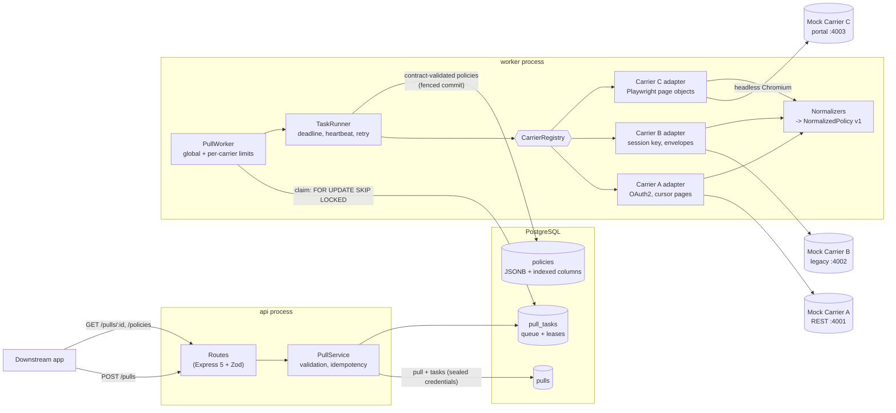
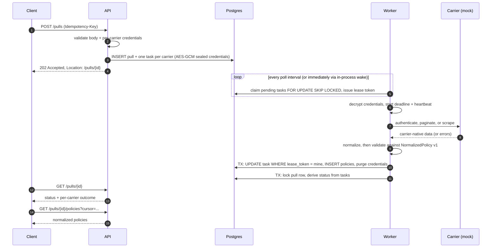
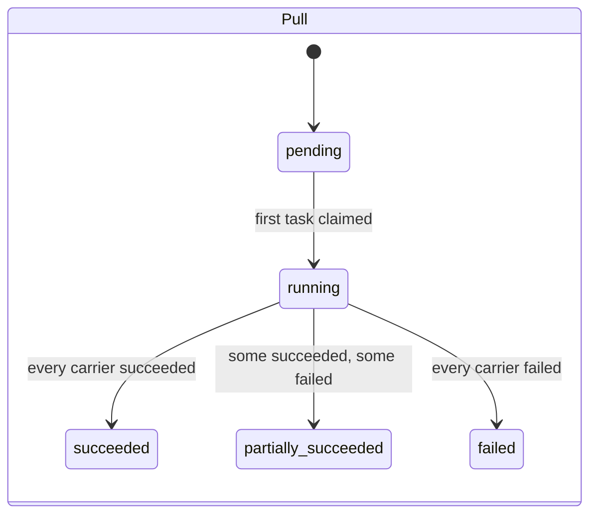
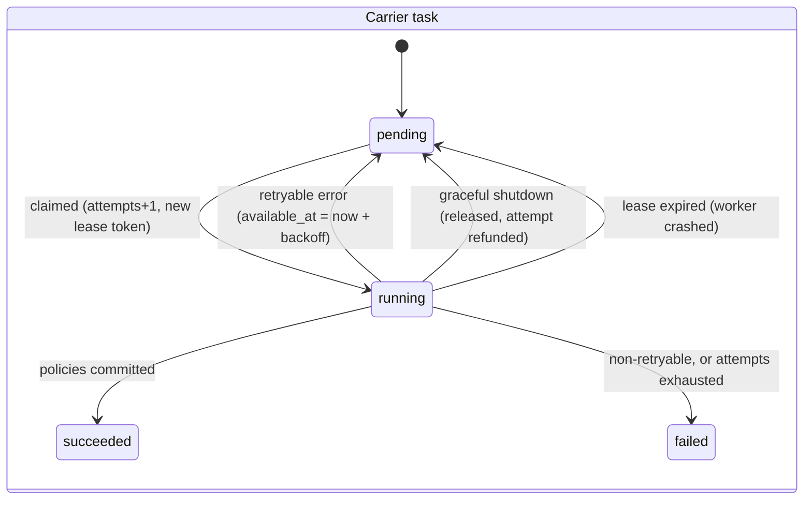

# Architecture

CarrierBridge is a modular monolith with two process roles, **api** and **worker**, that share one codebase, one image, and one Postgres database. Locally, `PROCESS_ROLE=all` runs both in one process. In Docker Compose they are separate containers, so the worker tier can scale independently.

## Components

### Layering

| Layer | Directory | Responsibility |
|---|---|---|
| Routing | `src/http/` | Parse and validate input (Zod), call services, present DTOs, map errors to RFC 9457 problems. No business logic. |
| Business logic | `src/services/` | Credential validation per carrier, idempotency, encryption of credentials, pagination rules. |
| Execution | `src/worker/` | Claiming, concurrency, deadlines, heartbeats, the retry-or-fail decision, contract enforcement. |
| Integrations | `src/carriers/` | One folder per carrier plus shared transport (HTTP client, browser manager). The only code that knows carrier formats. |
| Normalization | `src/normalization/`, `src/contracts/` | Pure functions plus the versioned contract. No I/O. |
| Persistence | `src/persistence/` | Prisma repositories and the SQL task queue. |
| Composition | `src/runtime.ts`, `src/main.ts` | Wires dependencies; process lifecycle and graceful shutdown. |

## Pull lifecycle

### State machines

A pull's status is a pure function of its task statuses (`src/domain/pull-status.ts`). It is recomputed under a `SELECT ... FOR UPDATE` row lock on the pull, so two carriers finishing at the same moment cannot race to write conflicting final states.

## The task queue

`pull_tasks` is a durable work queue implemented in plain SQL (`src/persistence/task-queue.ts`):

- **Claim:** `UPDATE ... FROM (SELECT ... WHERE status='pending' AND available_at <= now() ORDER BY available_at LIMIT n FOR UPDATE SKIP LOCKED)`. Any number of workers can poll without double-claiming or blocking each other.
- **Lease + heartbeat:** each claim sets `lease_expires_at`, and the runner extends it every `lease/3`. If a worker dies, a recovery sweep returns the task to `pending` (or fails it if out of attempts) and records `lease_expired` in `attempt_history`.
- **Fencing token:** each claim writes a fresh `lease_token`. Completion, rescheduling, failure, release, and heartbeat all use `WHERE lease_token = $mine`. A worker that stalls past its lease (GC pause, network partition) and then wakes up cannot commit stale results over the attempt that replaced it.
- **Atomic completion:** marking the task succeeded and inserting its policies happen in one transaction gated by the fencing check, so there are never half-written results.
- **Durable retry:** a retryable failure sets `available_at = now() + max(Retry-After, base · 2^(attempt-1))`. Backoff survives restarts because it lives in the row, not in a timer.

### Concurrency

The worker enforces two limits:

1. **Global** (`WORKER_CONCURRENCY`), which protects the process (sockets, memory, browser contexts).
2. **Per carrier** (`CARRIER_X_CONCURRENCY`, held on the registry entry), which protects the carrier from us. One slow or throttled carrier cannot consume every slot.

Carriers are visited round-robin on each tick so one carrier's backlog cannot starve the others. Inside an adapter, Carrier A fetches policy details through `mapWithConcurrency` (default 2), while Carrier C visits pages sequentially in one browser tab per customer session.

## Two layers of retry

| Layer | Where | Handles | Policy |
|---|---|---|---|
| Transport | `CarrierHttpClient` | 429, 500, 502, 503, 504, network errors, per-request timeouts | Idempotent requests only; exponential backoff with full jitter; honors `Retry-After` up to `CARRIER_HTTP_MAX_RETRY_AFTER_MS` |
| Task | `TaskRunner` + queue | Anything still `retryable` after transport retries: timeouts, outages, session churn | Persisted backoff, `TASK_MAX_ATTEMPTS`, full history in `attempt_history` |

A `Retry-After` longer than the in-process cap is not slept on. It surfaces as `rate_limited` with `retryAfterMs`, and the task is rescheduled durably for that time instead of holding a worker slot.

## Error taxonomy

Every failure that crosses the adapter boundary is a `CarrierError` (`src/domain/errors.ts`):

| Category | Retryable | Typical cause |
|---|---|---|
| `authentication` | no | Wrong password, locked account (including Carrier B's HTTP-200 `ReturnCode 100`) |
| `session_expired` | yes | Session died again right after re-authenticating |
| `rate_limited` | yes | 429 / Retry-After |
| `carrier_unavailable` | yes | 5xx, maintenance HTML page, connection refused |
| `timeout` | yes | Request timeout, navigation timeout, task deadline |
| `invalid_response` | no | Wrong content type, malformed JSON, unexpected envelope, portal layout changed |
| `cancelled` | — | Graceful shutdown or lost lease (released, not failed) |
| `internal` | no (by default) | Bugs, misconfiguration, tampered ciphertext |

Each error carries a stable `code` (`invalid_credentials`, `http_503`, `portal_layout_changed`, ...) that clients can branch on. Messages never include credentials, tokens, or raw carrier payloads.

## Browser integration (Carrier C)

- **One Chromium per worker, one `BrowserContext` per task.** Launching Chromium is expensive, while contexts are cheap and fully isolated (cookies, storage), so no customer session can leak into another.
- **Page objects** (`src/carriers/carrier-c/portal/pages.ts`) own navigation and extraction. **All selectors and labels** live in `portal/selectors.ts`.
- **Required vs optional elements.** Required anchors (login form, dashboard root, policy summary) are checked immediately after `domcontentloaded`; if one is missing, the adapter fails with `invalid_response/portal_layout_changed` instead of silently returning empty data. Optional sections (vehicles, drivers) are probed with `count()` without waiting, and absence maps to `null`.
- **Session expiry.** Any navigation that lands on `/login` triggers a re-login (capped at 5 per retrieval). The portal's `returnTo` brings the browser straight back, and the scraper does not re-navigate if it is already on the target page.
- **Cancellation.** The task's `AbortSignal` closes the browser context, which rejects every in-flight Playwright call promptly.
- **Signals.** Playwright is launched with `handleSIGTERM/SIGINT/SIGHUP: false`. By default it kills Chromium the instant the process receives SIGTERM, which cut off in-flight scrapes before the worker could drain; this was found by stopping the worker container mid-scrape and is covered by a regression test.

## Security model (simulated credentials)

- Credentials are validated at the API boundary, then sealed with **AES-256-GCM** using a subkey derived by HKDF from `CREDENTIALS_ENCRYPTION_KEY`. The task ID is bound in as additional authenticated data, so a ciphertext copied to another row will not decrypt.
- Ciphertexts are set to `NULL` the moment a task reaches a terminal state. Plaintext exists only in worker memory, wrapped in `Secret`, which renders as `[REDACTED]` in `toString`, `toJSON`, and `util.inspect`.
- The idempotency fingerprint is an **HMAC** of the canonical request body under a separate derived key. A plain hash of a body containing a password could be brute-forced by anyone with database access.
- Pino redacts sensitive keys (`password`, `credentials`, `authorization`, `access_token`, `SessionKey`, ...) at several depths. The HTTP client redacts sensitive query parameters (Carrier B's session key travels in the URL). Tests assert that no password, token, or session ID appears in responses or logs.
- Raw carrier payloads are **not** stored. `source.rawValues` keeps only the enumeration codes and the specific values that failed to parse.

## Observability

- Every request gets an `X-Request-Id` (a caller-supplied ID is accepted only if it is short and log-safe). It is echoed on responses and problem bodies, and stored on the pull as `correlation_id`.
- Worker logs are child loggers bound to `{ pullId, taskId, carrierId, attempt, correlationId }`, so one `grep` follows a request from HTTP into the carrier calls.
- Adapters return `stats` (requests, retries, pages, token refreshes, re-authentications), which are logged on completion.
- `GET /health` checks the database and returns 503 while the process is draining, so a load balancer stops routing before connections close.
